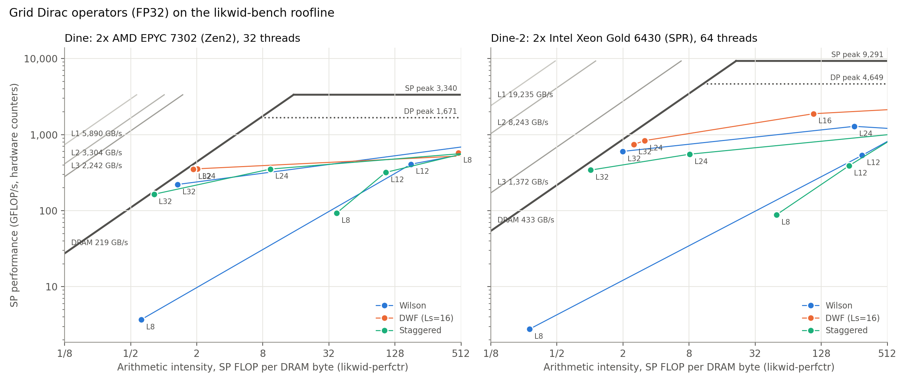
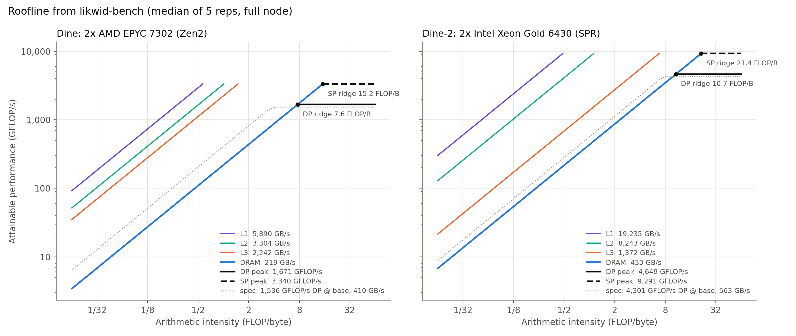
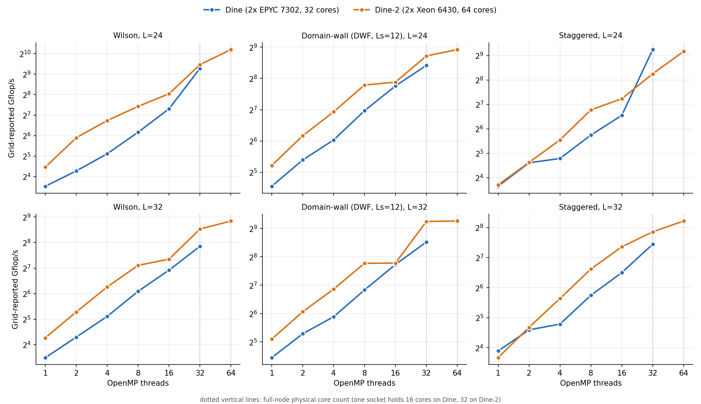

# CIUK Challenge 2: Roofline modelling of Dine and Dine-2 with LIKWID and Grid

Performance characterisation of two HPC nodes, using hardware counters and the roofline model.
Written for the CIUK Challenge 2 task on the DiRAC/COSMA Dine systems.

## Key takeaway

Measure the ceilings first, then place the application on them. I benchmarked the real compute and DRAM-bandwidth limits of two nodes with LIKWID, then ran the Grid lattice QCD benchmark under hardware counters.
Every Grid kernel turned out to be **memory-bound**, sitting at 68 to 92% of the measured DRAM roof but only 4 to 11% of peak SP FLOP/s.
Wider SIMD would not speed it up. More effective memory bandwidth would, which is why the DDR5 Dine-2 node is 2.1x to 2.7x faster than the DDR4 Dine node.
The numbers are cross-checked: counter-derived FLOP/s match Grid's own reporting to about 5%, and measured arithmetic intensities match analytic estimates.
Using theoretical specs instead would mislead: DRAM bandwidth is only 54% of spec on Dine, and AVX-512 clocks drop by about 30% under full load on Dine-2.

| Node | CPUs | SIMD | Memory |
|---|---|---|---|
| **Dine** | 2 x AMD EPYC 7302 (Zen 2), 32 cores | AVX2 | DDR4-3200, 16 channels |
| **Dine-2** | 2 x Intel Xeon Gold 6430 (Sapphire Rapids), 64 cores | AVX-512 | DDR5-4400, 16 channels |

The task had two parts:

1. **Task 1: measure the machine.** Find the real compute and memory-bandwidth ceilings of each node and compare them with the theoretical peaks.
2. **Task 2: place a real application on it.** Run the Grid lattice QCD benchmark, count its FLOPs and DRAM traffic with LIKWID, and see where its kernels land on the Task 1 roofline.

## What I did

**Task 1: [`task1-dine/`](task1-dine)**
- `bench.py` drives `likwid-bench` (peak FLOP/s, load/copy/stream/triad bandwidth, and a cache-size sweep from L1 to DRAM) and a reference STREAM build.
  Each point is the median of 5 repetitions, with threads pinned one per physical core.
- `compare.py` checks the measurements against the theoretical peaks and cross-checks `likwid-bench` against `likwid-perfctr` (CLOCK and FLOPS_DP groups).
- `roofline.py` builds the roofline from the measured ceilings.
- `baseline-run/` is the first iteration. `final-run/` is the final one, with pinned modules, a finer cache sweep and the results.

**Task 2: [`task2-grid/`](task2-grid)**
- Builds Grid and grid-benchmark from pinned commits (GCC 14.1, OpenMPI 5.0.3), with AVX2 on Dine and AVX-512 on Dine-2.
- `likwid-markers.patch` wraps only the timed Dslash loop in a LIKWID marker region.
  Counters then cover exactly the loop Grid times, so they can be compared directly with Grid's own Gflop/s.
- `job_sweep.sh` runs strong-scaling sweeps. `job_likwid.sh` collects the MEM and FLOPS_SP counters.
- `grid_parse.py`, `grid_plot.py` and `grid_roofline.py` turn the raw logs into the tables and plots in `results/`.

## Best results

**Measured machine ceilings (Task 1, median of 5 runs):**

| | Dine | Dine-2 |
|---|---|---|
| Peak DP | 1671 GFLOP/s (1.09x the base-clock spec) | 4649 GFLOP/s (1.08x) |
| Peak SP | 3340 GFLOP/s | 9291 GFLOP/s |
| DRAM bandwidth (`load`) | 219 GB/s (54% of 410 spec) | 433 GB/s (77% of 563 spec) |

- Compute beats the base-clock spec because the sustained clock is above base. Measured FLOP/s is 99% of the clock-based peak on Dine and about 95% on Dine-2.
- On Dine-2, AVX-512 DP drops from 3.27 GHz per core on one core to 2.27 GHz with a full socket active. Scaling from a single core would overestimate the node peak by about 45%.
- DRAM bandwidth is far below spec on Dine. Dine-2 gets much closer.

**Grid on the roofline (Task 2, full node, L = 32):**

| Node | Kernel | Arithmetic intensity (FLOP/B) | GFLOP/s | DRAM bandwidth used | % of DRAM roof |
|---|---|---|---|---|---|
| Dine | Domain-wall | 1.86 | 350 | 207 GB/s (94.5%) | 86% |
| Dine | Staggered | 0.82 | 164 | 201 GB/s (91.5%) | 92% |
| Dine-2 | Domain-wall | 2.51 | 742 | 292 GB/s (67%) | 68% |
| Dine-2 | Staggered | 1.02 | 342 | 330 GB/s (76%) | 78% |

- Every Grid kernel is memory-bound. Arithmetic intensity is 0.8 to 3 FLOP/B, against SP ridge points of 15 on Dine and 21 on Dine-2.
- Compute utilisation is only 4 to 11% of the SP peak. The gap to the roofline comes from the bandwidth term, so wider SIMD would not help.
- The measured arithmetic intensities match analytic estimates from the kernels' memory traffic.
  Staggered gives 0.96 and 1.02 against an estimate of 0.955. Wilson on Dine-2 at 32 threads gives 1.75 against 1.75.
- Counter-derived FLOP/s agree with Grid's own reported figure to within about 5%.
- Dine-2 is 2.1x to 2.7x faster than Dine at L = 32. That is about the 2x bandwidth ratio, plus higher arithmetic intensity on Dine-2.







## Reproducing

Jobs are Slurm scripts written for the DiRAC/COSMA Dine partitions. Edit the account and partition in the submit commands at the top of each script.

```bash
# Task 1
cd "task1-dine/final-run"
sbatch -p <partition> -A <account> job_probe.sh
sbatch -p <partition> -A <account> job_compute.sh zen2     # or spr
sbatch -p <partition> -A <account> job_memory.sh  zen2
python3 compare.py && python3 roofline.py

# Task 2
cd "task2-grid"
./fetch_sources.sh && sbatch job_build.sh <zen2|spr>
./submit_sweep.sh && ./submit_likwid.sh
python3 grid_parse.py results && python3 grid_roofline.py && python3 grid_plot.py results
```

All scripts are Python 3.13.6 (standard library plus matplotlib for plots) and bash.
Raw per-job stderr and environment dumps are not included. The Slurm output, JSON and counter logs needed to regenerate every table and plot are in the `results/` directories.

## Layout

```
task1-dine/baseline-run/   first iteration of the benchmarks
task1-dine/final-run/      final benchmarks, comparison and roofline (results/)
task2-grid/                Grid build, LIKWID patch, sweeps, parsing, plots (results/)
```

## Licence

MIT, see [`LICENSE`](LICENSE).
